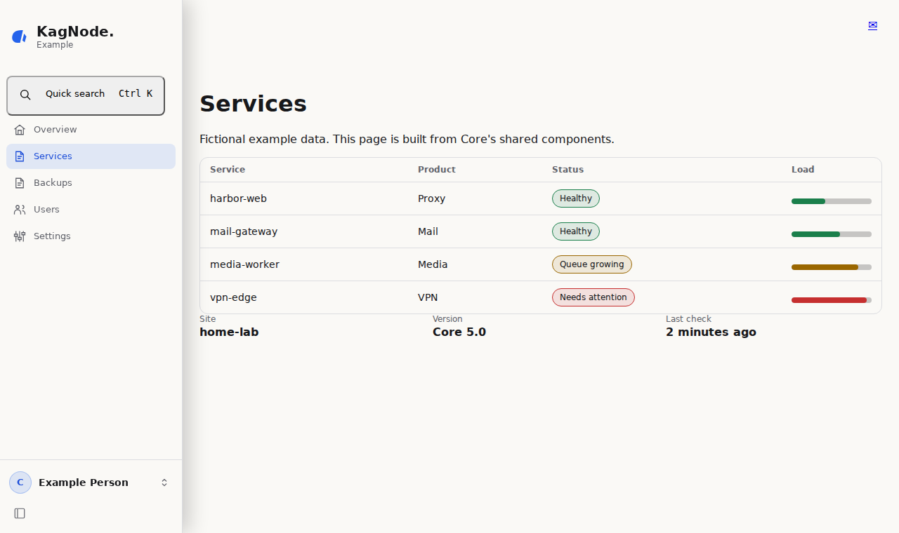
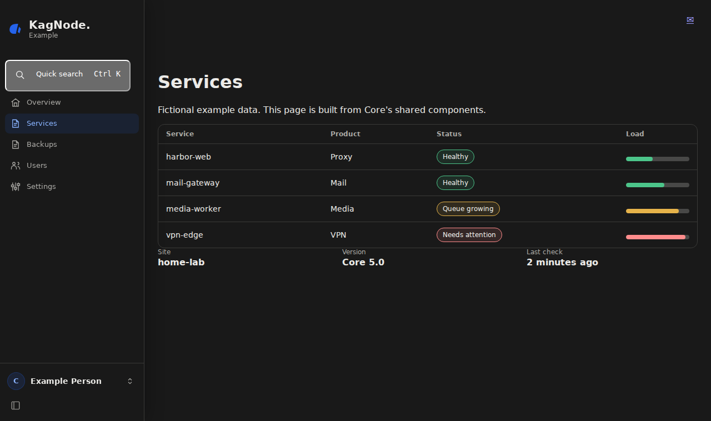
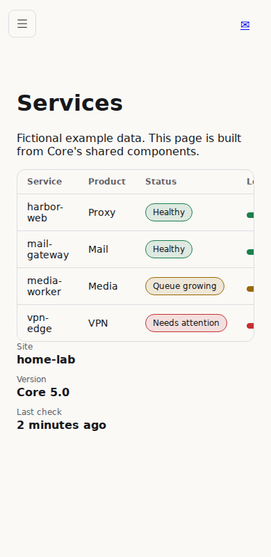

# KagNode Core

Shared web components and local asset delivery for the KagNode ecosystem.

## Overview

Core provides the common interface for KagNode websites and independently hosted applications. Application servers serve a pinned local bundle; browsers never need GitHub to start the interface. Application authorization and business rules remain in the host project.

### What it looks like

These screenshots come from Core's own browser-test fixture with fictional example data. No real account, host or service is shown. The layout shown (account at the bottom of the sidebar, icon-only collapse control, inbox at the top right) belongs to the pending 5.0.18/5.0.19 source and is not the layout of the currently deployed release.

| Light                                                                                                                              | Dark                                                                                                                              |
| ---------------------------------------------------------------------------------------------------------------------------------- | --------------------------------------------------------------------------------------------------------------------------------- |
|  |  |

The sidebar is 260 px wide, or a 57 px icon rail when collapsed. On a phone it becomes a drawer:

### How it works

1. **Your application serves Core.** A small adapter (Node, Python or Rust) copies a pinned, verified bundle onto your own server. The browser loads Core from your origin and never needs GitHub to start the interface.
2. **Core draws the shared parts.** It wraps your normal HTML in the common shell: sidebar, account menu, search, dialogs, form controls, loading states and login frame. You supply the links, the page content and what the signed-in person may see.
3. **You keep the decisions.** Core does not grant access or invent navigation. Authorization, business rules and data stay in your application.
4. **Updates are signed and limited.** A manager on the host checks the detached signature and checksums before it stores a new release. Only compatible UI patches are applied automatically, they cannot restart services, and the previous bundle is kept for rollback.
5. **Components for data pages.** Tables with captions, status badges, fact lists and usage meters follow the same tokens, and a confirmation dialog collects a password without leaving the page. See [components](docs/COMPONENTS.md) and [dialogs](docs/DIALOGS.md).
6. **Optional Administration folder.** A host can ask Core for an "Administration" folder in the sidebar. It appears only for a signed-in session, never on public pages, and every link must be http(s). Details are in [integration](docs/INTEGRATION.md).

## Release status

**5.0.0 is the coordinated KagNode stable UI contract.** It includes one branded login frame with shared form, provider, recovery and error presentation; viewport-safe account menus; native-motion scrolling; responsive navigation; and a selected set of the [320 original UI icons](docs/ICONS.md) used by actual components.

The remaining icon library is optional, with typed individual/category imports, SVG downloads and a searchable gallery. Servers verify and serve Core locally; browsers do not load Core code from GitHub. Applications explicitly adopt this major version and retain compatible patch policies. Backend helpers require separate review and are never installed by an automatic UI patch.

Stable Core describes the component, adapter and signed-update contract. It does not qualify application business rules, VPN networking, Mail delivery, Media codecs, HTTP Boot images or Bitwarden compatibility. Earlier 1.x releases remain available for existing deployments.

## Features

- One shared 260/57px sidebar, mobile drawer, icon account menu and restrained motion.
- Native wheel, touch and trackpad scrolling with accessible draggable rails.
- Shared fields, selectors, calendars, dialogs, loading, search, dashboard presentation and account preferences.
- Browser-to-account appearance connections with PKCE and origin-bound, revocable appearance-only grants.
- Offline adapters, signed UI-only updates, local administrator controls and rollback.

## Requirements

Node.js 24 for Node hosts/builds; Python 3.10+ for Python adapters; Rust 1.88+ for the Linux/Unix Rust adapter. Flask is optional for its adapter. The Linux asset manager requires OpenSSL, root-owned storage and Unix sockets. Browser functionality progressively enhances ordinary authorized HTML. Reduced motion, forced colors and native-scrolling preferences are supported.

## Installation and downloads

| Package                                                   | Platform              | Purpose                                                             |
| --------------------------------------------------------- | --------------------- | ------------------------------------------------------------------- |
| `kagnode-core-V-node.tgz`                                 | Node.js 24            | npm-compatible local adapter and pinned fallback                    |
| `kagnode_core-V-py3-none-any.whl`                         | Python 3.10+          | Python adapter, manager and pinned fallback                         |
| `kagnode-core-V-ui.tar.gz`, `.tar.xz`, `.zip`             | Browser assets        | Versioned assets; only the signed tar.gz is installed automatically |
| `kagnode-core-V-rust.tar.gz`, `.tar.xz`, `.zip`           | Rust 1.88+ Linux/Unix | Framework-independent local assets and manager transport            |
| `kagnode-core-V-source.*`                                 | Any                   | Editable source, tests, licenses and documentation                  |
| `kagnode-core-V-icons.tgz`, `-icons.tar.gz`, `-icons.zip` | Optional UI icons     | Typed glyph modules, individual SVGs and standalone local gallery   |

Use [releases](https://github.com/every-lemon/kagnode-core/releases). Verify `SHA256SUMS`; the manager additionally verifies the detached Ed25519 signature on `core-manifest.json`. Never substitute a third-party repository or an unverified manifest.

## Usage

Node: install the local npm archive, then call `installCore(app, {appId, context})` before routes. Python: install the wheel, then call `register_flask(app, app_id, context)` before request handling. Rust: vendor the versioned crate, construct `Core::new(root, application)` and expose its checked assets on the application origin. See [integration](docs/INTEGRATION.md). The [staged Rust manager](packages/manager-rust/README.md) provides a separately reviewed replacement for the current helper; it is not installed by a compatible UI patch. Existing authorized navigation and content are adopted into the canonical browser shell; adapters do not grant access or build private navigation.

## Configuration and storage

Applications commit `core.lock.json` with their baseline, adapter and compatible patch line. The manager stores immutable asset releases in `/srv/kagnode/core/releases/` and per-application bindings under `apps/`. Application databases, account passwords, encryption keys, native services and uploaded files remain in their existing locations. The bundled fallback starts offline even if the manager is unavailable.

## Security

Only compatible stable UI asset patches are automatic. They cannot contain backend hooks or restart services. Backend helpers, prereleases and minor/major changes require application review. The manager enforces fixed repository selection, signed inventories, bounded downloads, path checks, checksums, root ownership and per-app Unix socket permissions. Host applications must enforce local administrator authorization and CSRF. [Security details](docs/SECURITY.md).

Browser code is inspectable. Minification, fingerprints and attribution reduce accidental reuse; they do not make UI code copy-proof. Artwork permissions are separate from AGPL software licensing.

## Development and testing

Run `npm ci`, `npm run build`, `npm test`, `npm run check` and `npm run format:check`. Browser acceptance runs with `python tests/browser.py` after installing Playwright browsers. Set `KAGNODE_BROWSER_ENGINE=webkit` for WebKit. Tests use isolated fixtures rather than production accounts or media processing.

Build release archives with `python3 tools/package.py`. Signing is a separate trusted maintainer operation; private keys never belong in the repository. See [release operations](docs/OPERATIONS.md).

## Documentation

- [Repository map](docs/REPOSITORY-MAP.md)
- [Integration and component contract](docs/INTEGRATION.md)
- [Appearance connection protocol](docs/APPEARANCE.md)
- [Update operations and rollback](docs/OPERATIONS.md)
- [Artwork provenance](assets/provenance.json)
- [Original UI icons and gallery](docs/ICONS.md)
- [Component example](examples/server.mjs)
- [Changelog](CHANGELOG.md)

## Licensing

Software is AGPL-3.0-only; see [LICENSE](LICENSE). Imported KagNode artwork retains [its artwork permission](assets/ARTWORK-LICENSE). Public source and vendored corresponding source remain available with application packages.
